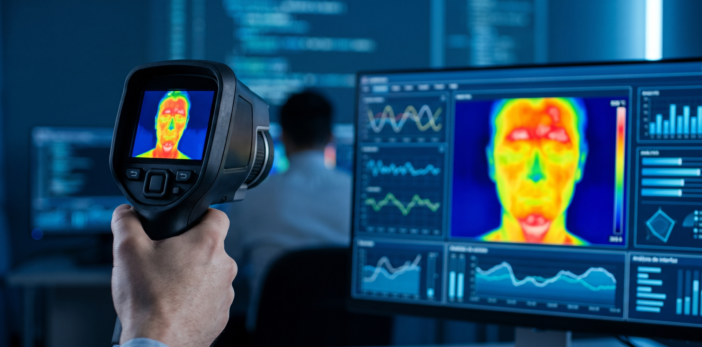

<p align="center">
  
</p>

# 🔬 Clasificador de Calidad y Calibración en Imágenes Termográficas Infrarrojas (IRT)

Este repositorio contiene el prototipo de visión por computadora desarrollado para la evaluación automática de calidad y calibración en capturas termográficas infrarrojas (IRT) mediante **Transfer Learning**.

---

## 📌 Paso 1: Definición del Problema y Selección Tecnológica

### 1.1. Dominio y Tarea de Clasificación
El sistema evalúa la validez de capturas térmicas clasificando cada imagen en 3 categorías mutuamente excluyentes:
1. **`Termografia_Valida_OK`**: Capturas térmicas limpias con gradiente cromático continuo y barra lateral de referencia calibrada (ej. `IV_00283.bmp`, de 25.7 °C a 32.1 °C).
2. **`Termografia_Descalibrada_Saturada`**: Capturas con pérdida de rango, paleta desajustada o saturación cromática que altera las isotermas.
3. **`Imagen_Fuera_de_Dominio_NA`**: Fotografías ópticas estándar, tomas borrosas o elementos ajenos al protocolo. La inclusión de la clase de control **`NA` (Unqualified)** se fundamenta en la metodología de He et al. (2020) para evitar la contaminación del entrenamiento.

### 1.2. Dataset Piloto y Hardware de Campo
- **Cámara de Inspección Piloto**: Testo 875-1i (resolución nativa 160 × 120 px, NETD < 50 mK).
- **Preprocesamiento**: Exportación desde el formato radiométrico del fabricante a `.bmp` y reescalado de tensores a **224 × 224 px** en PyTorch.

### 1.3. Justificación del Stack Tecnológico
- **Gestor de Entorno**: `uv` (garantiza entornos aislados y ejecuciones deterministas mediante `pyproject.toml` y `uv.lock`).
- **Framework**: PyTorch (`torchvision`) con interfaz interactiva en Gradio.
- **MobileNetV2 frente a Vision Transformers (ViT)**: Las redes convolucionales (CNN) incorporan **sesgo inductivo de localidad espacial e invariancia a la traslación**, presuponiendo que píxeles adyacentes forman bordes y gradientes térmicos contiguos. Esto permite al modelo generalizar eficientemente con datasets reducidos sin caer en *overfitting*, superando a los Transformers que requieren volúmenes masivos de datos para aprender relaciones espaciales.

---

## 🤖 Paso 2: Planificación con IA (Regla de Oro)

Siguiendo la pauta del laboratorio ("No escribir código antes"), la arquitectura del prototipo se estructuró mediante una sesión de diseño asistida por IA:
1. **Delimitación del Alcance**: Definición de un sistema agnóstico de hardware centrado en matrices de píxeles y tensores cromáticos.
2. **Estrategia de Transfer Learning**: Congelamiento de las capas convolucionales base de MobileNetV2 y reemplazo de la cabeza clasificadora lineal final por 3 salidas discretas.
3. **Diseño de Interfaz**: Definición de un pipeline ligero en Gradio capaz de procesar formatos crudos (`.bmp`, `.jpg`, `.heic`).

---

## 💻 Paso 3: Investigación, Experimentación y Desarrollo

### 3.1. Pipeline de Tensores e Inferencia Interna
1. **Transformación**: La imagen se escala a 224 × 224 px y se convierte en tensor numérico RGB.
2. **Normalización**: Se aplican la media ($\mu = [0.485, 0.456, 0.406]$) y desviación estándar ($\sigma = [0.229, 0.224, 0.225]$) de ImageNet.
3. **Rediseño de Cabeza**: Se sustituye el módulo lineal final en `model.classifier` por `nn.Linear(1280, 3)`.
4. **Softmax**: Convierte las salidas (*logits*) en una distribución porcentual probabilística ($\sum P_i = 1.0$).

### 3.2. Guía de Instalación y Ejecución

```bash
# 1. Sincronizar el entorno aislado con uv
uv sync

# 2. Ejecutar la interfaz gráfica local en Gradio
uv run app.py
---

## 🧪 Paso 4: Evaluación, Análisis de Robustez y Estado del Arte extendido

Siguiendo el protocolo de validación y contraste bibliográfico, la evaluación experimental del prototipo y su sustento académico se articularon en los siguientes puntos:

### 4.1. Análisis de Robustez y Límites del Modelo
1. **Procedimiento Experimental (OOD)**: Se evaluó la capacidad de respuesta del prototipo introduciendo imágenes ajenas al dominio de inspección termográfica (fotografías ópticas estándar, rostros y paisajes).
2. **Sesgo de Conjunto Cerrado y Límites de Softmax**: Al tratarse de un clasificador de 3 clases predefinidas, la función Softmax fuerza la suma de probabilidades a 1.0 (100%), asignando una certeza falsamente elevada (> 90%) a muestras no térmicas. Esto demuestra de manera crítica que la métrica mide similitud matemática relativa entre tensores y no certeza lógica o física del contenido.
3. **Manejo de Incertidumbre y Umbral de Confianza (*Confidence Threshold*)**: Para mitigar decisiones forzadas en la frontera de decisión (ej. predicciones cercanas de 44% vs 42% entre clases limítrofes), se definió una regla post-inferencia: si la clase principal no supera el **70% de confianza**, la toma se clasifica automáticamente como **`Dudosa / Requiere Inspección Humana`**.

### 4.2. Estado del Arte Ampliado y Referencias Científicas
1. **Filtro de Calidad y Clase de Control NA (*Unqualified*)**: **He et al. (2020)** (*Int. J. Comput. Assist. Radiol. Surg.*). Fundamenta la inclusión de una categoría de control explícita para descartar capturas ruidosas, borrosas o fuera de protocolo antes de entrenar la red, previniendo la contaminación del espacio latente supervisado.
2. **Normalización Estadística y Fisiología en IRT**: **Razmara et al. (2024)** (*IEEE / arXiv:2407.15302v2*). Demuestra que aislar regiones fisiológicamente estables (como el canto interno del ojo) mediante normalización estadística y redes convolucionales minimiza el error metrológico ($\text{RMSE} < 0.23 \text{ °C}$).
3. **Segmentación Avanzada y Fusión Multimodal (Perspectiva Futura)**: **Xu et al. (2026)** (*Animals / MDPI*). Propone una arquitectura de dos etapas combinando detectores (YOLOv8/v11, Mask R-CNN) para aislar la Región de Interés (ROI) con modelos híbridos (CNN + Transformer + Random Forest), incorporando variables climáticas (humedad y viento) para compensar la varianza cromática del sensor.
4. **Repositorios Públicos de Referencia (`repositorio.txt`)**: Conjuntos de datos abiertos en Mendeley Data y Kaggle utilizados para el cotejo de paletas térmicas, patrones de calibración y análisis de generalización.
---

## 🚀 Paso 5: Perspectivas a Futuro (Roadmap del Proyecto)

Siguiendo la evolución técnica planificada para el sistema, el escalamiento del clasificador se estructuró en cinco líneas prioritarias:
1. **Segmentación Automática de ROI (*Region of Interest*)**: Integrar detectores de objetos (YOLOv8/v11 o Mask R-CNN) para aislar la ventana de inspección y la escala cromática lateral antes de la inferencia, eliminando el sesgo del fondo.
2. **Fusión Multimodal con Variables Ambientales**: Incorporar la medición síncrona de microclima (temperatura ambiente, humedad relativa y velocidad del viento) junto con los tensores térmicos para corregir la varianza del sensor y asegurar precisión radiométrica ($\text{RMSE} < 0.23 \text{ °C}$).
3. **Arquitectura Híbrida de Dos Etapas**: Evolucionar desde la clasificación supervisada simple hacia un pipeline híbrido (CNN + FCNN + Transformer + Random Forest) que combine la extracción de características espaciales con modelos de regresión para ajuste de residuos.
4. **Filtro de Seguridad por Umbral de Confianza (*Confidence Threshold*)**: Implementar una regla post-inferencia que derive a inspección humana cualquier captura cuyo valor de confianza en Softmax sea inferior al 70%, evitando decisiones forzadas en la frontera de decisión.
5. **Expansión del Dataset con Fuentes Públicas**: Enriquecer el conjunto de datos piloto integrando repositorios térmicos abiertos (Mendeley Data y Kaggle) para evaluar la generalización del modelo ante diferentes marcas y resoluciones de sensores.

---

## 📚 Paso 6: Glosario y Vocabulario de Referencia Técnica

Para garantizar la precisión conceptual y terminológica en la documentación y evaluación del prototipo, se definen los términos clave del sistema:
- **Modelo (*Model*)**: Aproximación funcional de un sistema real expresada mediante una estructura matemática específica, cuyos parámetros se optimizan para minimizar una función de pérdida utilizando un conjunto de datos observados. En este proyecto, corresponde a la red MobileNetV2 reconfigurada para clasificar patrones cromáticos térmicos.
- **IRT (*Infrared Thermography* / Termografía Infrarroja)**: Técnica de inspección no destructiva que mapea la radiación electromagnética en la banda del infrarrojo emitida por una superficie, traduciendo firmas térmicas en matrices de valores o representaciones pseudo-cromáticas.
- **Aprendizaje por Transferencia (*Transfer Learning*)**: Estrategia de entrenamiento en aprendizaje profundo donde una red preentrenada en un dominio masivo (ej. ImageNet) transfiere sus representaciones de características de bajo nivel a una nueva tarea específica, ajustando únicamente las capas clasificadoras finales.
- **MobileNetV2**: Arquitectura convolucional ligera optimizada para inferencia en dispositivos de borde (*edge computing*), caracterizada por el uso de convoluciones separables en profundidad (*depthwise separable convolutions*) y bloques residuales invertidos (*inverted residuals*).
- **Sesgo Inductivo (*Inductive Bias*)**: Conjunto de supuestos apriorísticos incorporados en la arquitectura de un algoritmo para priorizar ciertas hipótesis sobre otras. En las CNN, presupone localidad espacial (correlación entre píxeles adyacentes) e invariancia a la traslación.
- **Vision Transformers (ViT)**: Arquitectura basada en mecanismos de atención global que procesa imágenes descomponiéndolas en parches secuenciales (*tokens*). A diferencia de las CNN, carece de sesgo inductivo espacial rígido, requiriendo volúmenes masivos de datos para aprender relaciones estructurales.
- **Logits**: Vector de salidas numéricas crudas sin acotar producido por la capa lineal final (`nn.Linear`) de un modelo de clasificación, antes de ser transformado en una distribución de probabilidad.
- **Softmax**: Función de activación vectorial que normaliza un conjunto de logits no acotados en una distribución de probabilidad acotada entre 0 y 1, donde la suma de todos los componentes es estrictamente igual a 1.0.
- **OOD (*Out-of-Distribution* / Muestras Fuera de Distribución)**: Tensores de entrada cuyos patrones estadísticos o visuales difieren significativamente del espacio de características presentado durante la fase de entrenamiento del modelo.
- **Sesgo de Conjunto Cerrado (*Closed-Set Bias*)**: Limitación estructural de los clasificadores supervisados mediante la cual la red está forzada a mapear cualquier entrada a una de las $K$ clases predefinidas en su capa de salida, independientemente de la validez real de la muestra.
- **Umbral de Confianza (*Confidence Threshold*)**: Regla de decisión post-inferencia que establece un límite mínimo de probabilidad requerida en la predicción principal para aceptar la inferencia del modelo; si la probabilidad no alcanza el umbral, la muestra se deriva a revisión o descarte.
- **ROI (*Region of Interest* / Región de Interés)**: Subconjunto espacial delimitado dentro de una matriz de datos o imagen que concentra la información cromática o térmica relevante para el análisis, excluyendo el fondo o elementos ruidosos.
- **Clase de Control NA (*Unqualified* / Fuera de Dominio)**: Categoría explícita dentro del esquema de etiquetado supervisado orientada a capturar muestras fuera de protocolo, ruidosas o defectuosas, protegiendo el espacio de representaciones de las clases principales.
- **NETD (*Noise Equivalent Temperature Difference*)**: Métrica estandarizada de sensibilidad térmica que cuantifica la mínima diferencia de temperatura que un detector infrarrojo puede distinguir por encima del nivel de ruido del sensor.
---