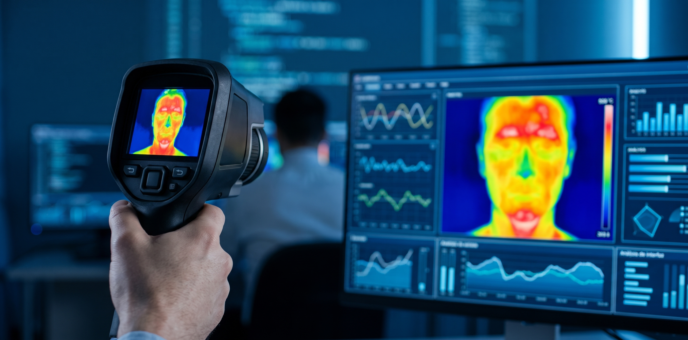

<p align="center">
  
</p>

# Clasificador y Validador de Cámaras Termográficas (IRT)

Aplicación en Python desarrollada con **PyTorch** y **Gradio** para clasificar capturas termográficas infrarrojas y evaluar, a nivel de imagen, si una cámara térmica cumple criterios operativos de calibración o presenta síntomas de falla del sensor.

---

## Clases del modelo

El sistema resuelve una clasificación supervisada de imágenes en tres categorías definidas en `app.py`:

1. **`Imagen_Fuera_de_Dominio_NA`**: Capturas que no presentan características de radiometría o espectro infrarrojo procesable. Su inclusión se inspira en la clase de control `unqualified` / `NA` propuesta por He et al. (2020) para aislar tomas ruidosas, borrosas o ajenas al protocolo.
2. **`Termografia_Descalibrada_Saturada`**: Imágenes con saturación térmica severa o asimetría grave en la respuesta del sensor que invalidan la medición.
3. **`Termografia_Valida_OK`**: Capturas térmicas operativas que conservan contraste, sensibilidad en rango dinámico y calibración adecuada.

---

## Estructura del proyecto

```text
clasificador-termografia/
├── assets/
│   └── TIR.png
├── data/                                    # Dataset local (ignorado en Git)
│   ├── Imagen_Fuera_de_Dominio_NA/          # Imágenes de control fuera de dominio
│   ├── Termografia_Descalibrada_Saturada/   # Capturas saturadas o descalibradas
│   ├── Termografia_Valida_OK/               # Capturas válidas (IV_00265.bmp ... IV_00302.bmp)
│   │   └── IV_00283.bmp                     # Muestra termográfica de referencia para la demo
│   └── prueba1.jpg                          # Archivo de prueba suelto en data/
├── .gitignore                               # Excluye .venv/, __pycache__/, .gradio/, *.pth y data/
├── app.py                                   # Interfaz web Gradio, inferencia y simulador de fallas
├── model.pth                                # Pesos entrenados por train.py (ignorado en Git)
├── pyproject.toml                           # Metadatos y dependencias del proyecto (Python >= 3.12)
├── README.md                                # Documentación técnica del repositorio
├── train.py                                 # Entrenamiento por Transfer Learning con MobileNetV2
└── uv.lock                                  # Bloqueo reproducible de dependencias
```

> **Notas sobre `data/` y `.gitignore`:**
> * `.gitignore` excluye `.venv/`, `__pycache__/`, `*.pyc`, `.cache/`, `.gradio/`, `*.pth`, `data/`, `Thumbs.db` y `.DS_Store`. Al clonar el proyecto por primera vez es necesario contar con la carpeta `data/` y ejecutar `train.py` para generar `model.pth` (si `model.pth` no está presente, `app.py` emite un aviso por consola e inicializa la arquitectura base sin pesos entrenados).
> * `train.py` recorre únicamente los subdirectorios dentro de `data/` (`if d.is_dir()`). Por ello, `data/Termografia_Valida_OK/IV_00283.bmp` participa en el entrenamiento de la clase válida, mientras que archivos sueltos en la raíz de `data/` (como `data/prueba1.jpg`) quedan fuera del entrenamiento y pueden usarse como prueba independiente.
> * Si en tu carpeta local existen directorios auxiliares no contemplados en `.gitignore` (por ejemplo `.venv-1/`, `.vscode/` o carpetas externas de datasets), verifica con `git status` antes de hacer `commit` o `push`.

---

## Requisitos e instalación

Según `pyproject.toml`, el proyecto (`clasificador-termografia`, versión `0.1.0`) requiere **Python >= 3.12** y las siguientes dependencias:

* `torch >= 2.15.0` y `torchvision >= 0.29.2`
* `gradio >= 6.31.0`
* `pillow >= 12.3.0` (carga y conversión a RGB de capturas `.bmp`, `.png`, `.jpg`, `.tif`)
* `pillow-heif >= 1.8.1` (declarada en `pyproject.toml`; no utilizada en el flujo estándar sobre `.bmp`)
* `markdown-pdf >= 1.13.3`

Para sincronizar el entorno virtual con `uv`:

```bash
uv sync
```

*(En Windows, si el proyecto se encuentra en una carpeta sincronizada por OneDrive, se recomienda pausar la sincronización o ejecutar con `$env:UV_LINK_MODE = "copy"` para evitar bloqueos de archivos en `.venv`).*

---

## Entrenamiento (`train.py`)

El script `train.py` entrena el clasificador aplicando **Transfer Learning** sobre `MobileNetV2`:

1. **Carga y etiquetado automático:** Lee los subdirectorios dentro de `data/` en orden alfabético como nombres de clase y procesa imágenes en formato `.jpg`, `.jpeg`, `.png`, `.bmp`, `.tif` y `.tiff` convertidas a RGB.
2. **Aumentación de datos:** Por cada imagen original genera `1` tensor base (`Resize((224, 224))`) y `8` muestras aumentadas (`SAMPLES_PER_IMAGE = 8`) mediante `Resize((256, 256))`, `RandomCrop(224)`, `RandomHorizontalFlip()` y `RandomRotation(degrees=12)`, normalizadas con la media `[0.485, 0.456, 0.406]` y desviación estándar `[0.229, 0.224, 0.225]` de ImageNet.
3. **Arquitectura y congelamiento:** Carga `MobileNet_V2_Weights.DEFAULT`, congela las capas extractoras de características (`requires_grad = False`) y reemplaza `model.classifier` por `nn.Sequential(nn.Dropout(p=0.2), nn.Linear(in_features, len(classes)))`.
4. **Optimización y guardado:** Entrena durante `15` épocas con `batch_size = 8`, función de pérdida `CrossEntropyLoss` y optimizador `Adam` (`lr = 0.001`, `weight_decay = 1e-3`), guardando los pesos resultantes en `model.pth`.

```bash
uv run train.py
```

---

## Ejecución e interfaz web (`app.py`)

```bash
uv run app.py
```

Al iniciar `demo.launch()`, se habilita la interfaz `gr.Blocks` en el navegador (`127.0.0.1:7860`) con los siguientes controles y salidas:

### Controles de entrada
* **Cargar Captura Térmica:** Acepta imágenes estándar en formato `.bmp` (por ejemplo, la muestra **`data/Termografia_Valida_OK/IV_00283.bmp`**), `.png`, `.jpg` o `.tiff`.
* **Umbral de Confianza Requerido (%):** Deslizador interactivo entre `50.0` y `99.0` (valor inicial `85.0`, paso `1.0`).
* **Simulación de Fallas de Campo (`simular_camara_averiada`):** Selector para degradar sintéticamente una captura válida en tiempo de prueba y demostrar la respuesta frente a fallas del sensor microbolómetro:
  * `Ninguna (Normal)`
  * `Saturación Térmica / Offset` (incremento de canal rojo con `offset_saturacion = 150` y verde proporcional)
  * `Falla Obturador NUC (Gradiente)` (gradiente horizontal parásito lineal de `0` a `110`)
  * `Píxeles Muertos / FPN` (`6` filas horizontales fijas en `[255, 255, 0]` y `4%` de píxeles ciegos en `[255, 0, 0]`)

### Pipeline de inferencia y dictámenes
La imagen ingresada (por ejemplo, `data/Termografia_Valida_OK/IV_00283.bmp`) se convierte a RGB, se redimensiona a `224 × 224` píxeles, se normaliza con los parámetros de ImageNet y se evalúa en modo `eval()` bajo `torch.no_grad()`, aplicando `softmax(outputs[0], dim=0)` para obtener las probabilidades de cada clase.

La interfaz muestra la imagen analizada, el gráfico de probabilidades (`gr.Label`) y un **Certificado de Operatividad** en formato HTML (`gr.HTML`):

| Condición evaluada | Dictamen emitido | Criterio operativo |
| :--- | :--- | :--- |
| `Termografia_Valida_OK` y confianza $\ge$ umbral | **Cámara operativa y calibrada** (Verde) | La cámara cumple criterios de contraste, rango dinámico y calibración operativa |
| `Termografia_Valida_OK` y confianza $<$ umbral | **Validación técnica ambigua** (Ámbar) | Certeza insuficiente frente al umbral; repetir captura ajustando enfoque y distancia |
| `Termografia_Descalibrada_Saturada` | **Cámara fuera de servicio / descalibrada** (Rojo) | Saturación térmica destructiva o asimetría grave; retirar de operación para calibración |
| `Imagen_Fuera_de_Dominio_NA` | **Imagen fuera de dominio** (Gris) | Archivo sin radiometría o espectro infrarrojo procesable |

---

## Límites observados y criterios de validación

* **Sensibilidad ante defectos puntuales finos (`Píxeles Muertos / FPN`):** Durante pruebas en Gradio sobre la muestra **`data/Termografia_Valida_OK/IV_00283.bmp`** (`25,7 °C` a `32,1 °C`) con el umbral en `77%` y la simulación `Píxeles Muertos / FPN` activa, el modelo clasificó la toma como `Termografia_Valida_OK` con `92,52%` de confianza (`93%` en barra frente a `4%` de `Imagen_Fuera_de_Dominio_NA` y `4%` de `Termografia_Descalibrada_Saturada`). Esto ocurre porque las `6` líneas de `1` píxel y el `4%` de píxeles dispersos se atenúan al redimensionar la imagen a `224 × 224` píxeles y el entrenamiento actual en `train.py` solo aplica aumentaciones geométricas globales. En contraste, fallas de impacto global como `Saturación Térmica / Offset` o `Falla Obturador NUC (Gradiente)` alteran de forma continua la distribución cromática.
* **Comportamiento de conjunto cerrado en Softmax:** En `app.py`, `torch.nn.functional.softmax(outputs[0], dim=0)` distribuye obligatoriamente el `100%` de la probabilidad entre las tres clases definidas en `CLASS_NAMES`, midiendo similitud matemática relativa respecto de los ejemplos de entrenamiento y no certeza física absoluta. La inclusión de la categoría de control `Imagen_Fuera_de_Dominio_NA` (inspirada en He et al., 2020) y el deslizador de umbral (`threshold_slider`) permiten aislar entradas no procesables y derivar predicciones dudosas al dictamen ámbar.
* **Verificación en campo vs. calibración certificada:** Este clasificador actúa como control preventivo a nivel de imagen y no reemplaza una calibración oficial en laboratorio certificado frente a un cuerpo negro (recomendada cada 12 meses), ni sustituye las comprobaciones funcionales de campo (referencia de mezcla agua-hielo a `0 °C` con tolerancia `±2 °C`, o verificación sobre el conducto lagrimal interno humano entre `34 °C` y `37 °C` ajustando emisividad entre `0.95` y `0.98`, enfoque manual y distancia).

---

## Referencia metodológica

* He, Q., Bano, S., Ahmad, O. F., Yang, B., Chen, X., Valdastri, P., Lovat, L. B., Stoyanov, D., & Zuo, S. (2020). *Deep learning-based anatomical site classification for upper gastrointestinal endoscopy*. International Journal of Computer Assisted Radiology and Surgery, 15, 1085–1094.
